

  <a href="./assets/banner.svg#gh-dark-mode-only">
    
  </a>
  <a href="./assets/banner-light.svg#gh-light-mode-only">
    
  </a>

 

  
  

 

  
  

## Sobre mim

Sou **Victor Hugo Domingos Bastos**, de Lorena (SP), formado como **Técnico em Informática para Internet** e atualmente em formação simultânea na graduação em **Gestão da Tecnologia da Informação** pela **FATEC Guaratinguetá** e no curso técnico em **Automação Industrial** pelo **SENAI Pindamonhangaba**.

Minha trajetória se desenvolve na interseção entre o ambiente físico das máquinas e o ambiente digital dos sistemas e dados — permitindo transitar entre painéis de comando elétrico e a estruturação de aplicações em software.

- **Automação Industrial e Operação:** venho consolidando base prática em eletroeletrônica, comandos e acionamentos elétricos, manutenção industrial e elétrica, sistemas pneumáticos e hidráulicos, parametrização de inversores de frequência e programação de CLPs em linguagem Ladder no **Siemens TIA Portal**, compreendendo o funcionamento integrado de equipamentos no chão de fábrica.
- **Tecnologia da Informação e Software:** aplico minha base técnica e a graduação em Gestão de TI na construção de sistemas web e organização de dados. Pratico o ecossistema **JavaScript/TypeScript** (**React**, **Vite**, **Node.js**, **Express** e **MySQL**), além de estudos em **C#** e **C++**.
- **Direcionamento profissional:** busco evoluir na integração entre tecnologia da informação e sistemas industriais, com foco futuro no desenvolvimento de telas de supervisórios, IHMs, dashboards operacionais e aplicações de apoio à tomada de decisão na Indústria 4.0.

<table>
  <thead>
    <tr>
      <th align="left" width="50%">Formação Acadêmica e Técnica</th>
      <th align="left" width="50%">Frentes de Atuação e Estudo</th>
    </tr>
  </thead>
  <tbody>
    <tr>
      <td valign="top">
        <strong>Graduação (em andamento)</strong> 
        Gestão da Tecnologia da Informação — FATEC Guaratinguetá  
        <strong>Técnico (em andamento)</strong> 
        Automação Industrial — SENAI Pindamonhangaba  
        <strong>Técnico (concluído)</strong> 
        Informática para Internet
      </td>
      <td valign="top">
        <strong>Desenvolvimento de Software</strong> 
        Interfaces web responsivas, APIs REST e bancos de dados relacionais  
        <strong>Automação e Manutenção Industrial</strong> 
        CLP, IHM, TIA Portal, Ladder Logic, acionamentos elétricos e inversores  
        <strong>Integração TI + Indústria</strong> 
        Sistemas industriais, dados operacionais e supervisão voltada à decisão
      </td>
    </tr>
  </tbody>
</table>

 

  
  

## Tecnologias e Ferramentas

Conjunto de linguagens, ferramentas de software e tecnologias industriais presentes nos meus projetos acadêmicos, estudos técnicos e práticas de laboratório.

<table>
  <tbody>
    <tr>
      <td width="28%" valign="middle"><strong>Linguagens de programação</strong></td>
      <td valign="middle">
        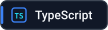
        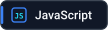
        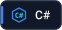
        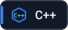
      </td>
    </tr>
    <tr>
      <td valign="middle"><strong>Desenvolvimento front-end</strong></td>
      <td valign="middle">
        
        
        
        
      </td>
    </tr>
    <tr>
      <td valign="middle"><strong>Desenvolvimento back-end</strong></td>
      <td valign="middle">
        
        
      </td>
    </tr>
    <tr>
      <td valign="middle"><strong>Banco de dados</strong></td>
      <td valign="middle">
        
      </td>
    </tr>
    <tr>
      <td valign="middle"><strong>Versionamento e ferramentas</strong></td>
      <td valign="middle">
        
        
        
      </td>
    </tr>
    <tr>
      <td valign="middle"><strong>Automação industrial</strong></td>
      <td valign="middle">
        
        
        
        
        
        
        
        
      </td>
    </tr>
    <tr>
      <td valign="middle"><strong>Sistemas e ferramentas de desenvolvimento</strong></td>
      <td valign="middle">
        
        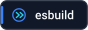
        
        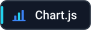
        
      </td>
    </tr>
  </tbody>
</table>

 

  
  

## Projetos em Destaque

### Clínica Ikigai

  <a href="https://github.com/domingossss/Clinica_Ikigai#gh-dark-mode-only">
    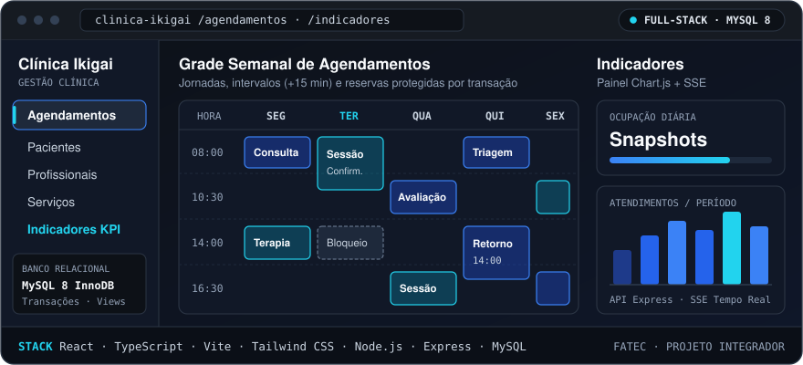
  </a>
  <a href="https://github.com/domingossss/Clinica_Ikigai#gh-light-mode-only">
    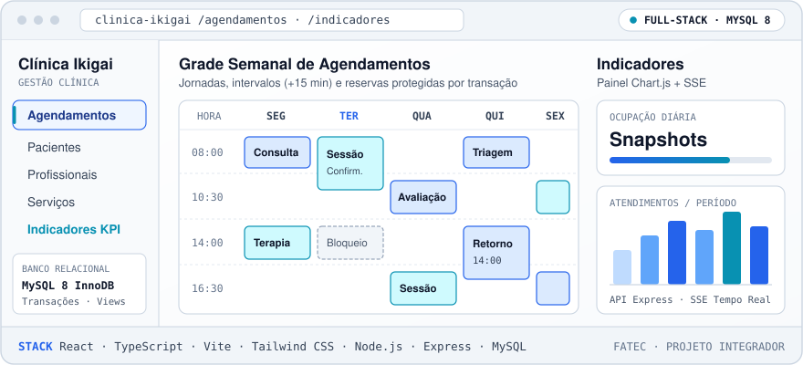
  </a>

Sistema web full-stack de gestão clínica desenvolvido no Projeto Integrador do 3º semestre de Gestão da Tecnologia da Informação (FATEC Guaratinguetá).

- **Objetivo:** unificar a operação da recepção e o acompanhamento de indicadores gerenciais em uma mesma arquitetura, reunindo grade diária e semanal de agendamentos protegida por transações contra conflitos de horário, cadastro de pacientes com controle de edição concorrente, gestão de profissionais/jornadas e painel analítico.
- **Tecnologias:** `React` `TypeScript` `Vite` `Tailwind CSS` `Chart.js` `Node.js` `Express` `MySQL`
- **Acesso:** [Repositório no GitHub](https://github.com/domingossss/Clinica_Ikigai) · *Execução local (monorepo npm workspaces + MySQL 8)*

 

### VITTAIA

  <a href="https://vittaia.vercel.app#gh-dark-mode-only">
    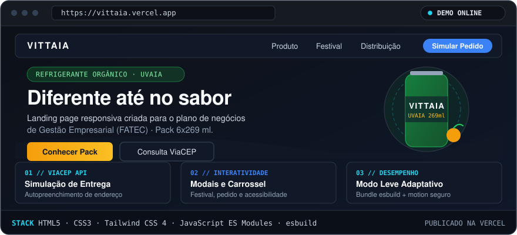
  </a>
  <a href="https://vittaia.vercel.app#gh-light-mode-only">
    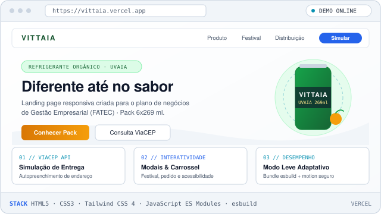
  </a>

Landing page estática e responsiva desenvolvida como colaborador externo para a marca fictícia de refrigerante orgânico de uvaia, em apoio ao plano de negócios de Gestão Empresarial (FATEC Guaratinguetá).

- **Objetivo:** traduzir uma proposta acadêmica de produto em uma interface navegável e otimizada, reunindo apresentação da marca, modais interativos, simulação de pedido e frete, preenchimento automático de endereço via API pública ViaCEP, carrossel acessível e modo leve adaptativo (`prefers-reduced-motion`).
- **Tecnologias:** `HTML5` `CSS3` `Tailwind CSS 4` `JavaScript (ES Modules)` `esbuild` `ViaCEP` `Vercel`
- **Acesso:** [Repositório no GitHub](https://github.com/domingossss/VITTAIA) · [Demonstração Online](https://vittaia.vercel.app)

 

  
  

## GitHub Analytics

  
  
  
  

 

  
  

 

  
  

 

  
  

 

  
  

 

  
  

## Redes Sociais e Contato

Aberto a conexões, troca de experiências e oportunidades nas áreas de Tecnologia da Informação, Desenvolvimento de Software e Automação Industrial.

  
  &nbsp;&nbsp;
  

 

  <a href="./assets/footer.svg#gh-dark-mode-only">
    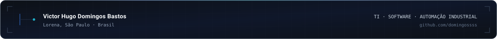
  </a>
  <a href="./assets/footer-light.svg#gh-light-mode-only">
    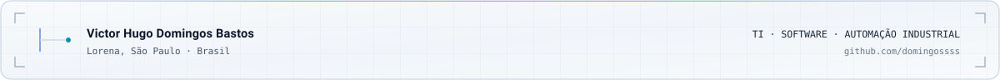
  </a>

